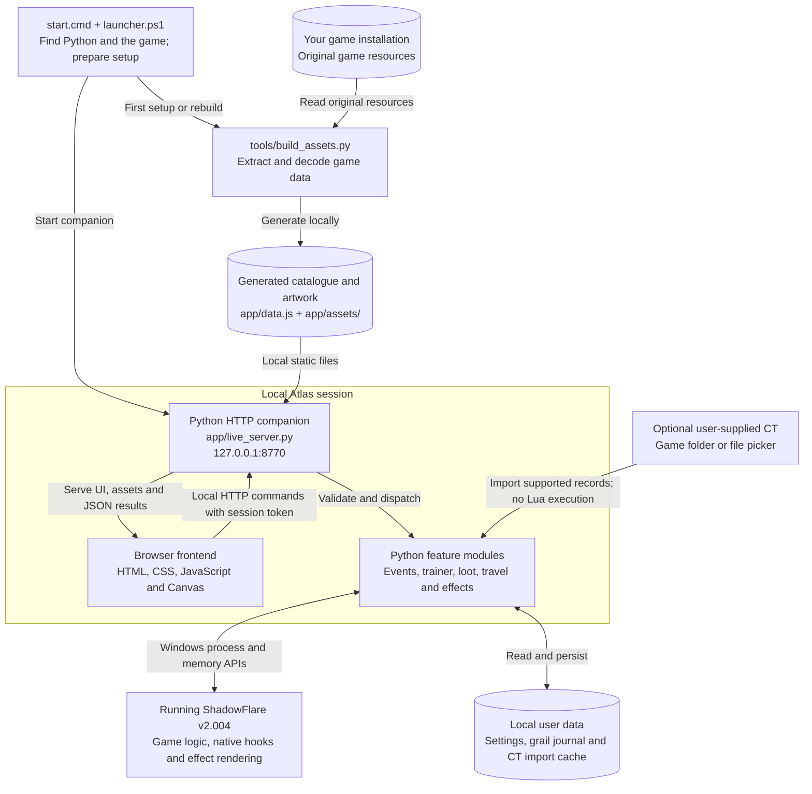

# ShadowFlare Atlas Core

> [!WARNING]
> **Experimental. Educational. Built for curiosity and fun.**
>
> This is an independent hobby project exploring the data formats, rendering
> and runtime behavior of a classic game. It is a work in progress, provided
> **AS IS**, without warranties of any kind. Features may be incomplete,
> unstable or incompatible with your installation, and live controls can
> change game memory and progress subsequently written to your saves.
>
> **Use it at your own risk.** To the fullest extent permitted by applicable
> law, the authors and contributors accept no liability for problems, losses
> or damage arising from its use, including crashes, corrupted saves, lost
> progress or other software issues. See the [0BSD license](LICENSE).
>
> **Review before you run.** Carefully inspect the source code, setup scripts,
> feature documentation and any CT file you supply. Make independent backups
> of your game and saves, and test on a separate copy before using valuable
> characters. Built-in checks and automatic backups are not a guarantee of
> safety or recovery. If you do not understand an operation, leave it disabled
> until you have reviewed it.

An offline item, monster and world-map atlas for **ShadowFlare v2.004**, with
an optional Windows companion for live, single-player controls: a trainer,
drop and EXP events, UI corrections, loot improvements and a character-based
Premium collection journal.

This edition excludes the game-language translation patch, its text corpus,
resource recipes, installer commands and replay endpoint. Its Git history
starts from this edition; the previous repository history is not included.
No external trainer table, table records or third-party resolution-helper
implementation is bundled. A CT can be imported locally by its owner. The
Atlas interface supports Turkish and English through the **TR / EN** buttons
in the top-right corner. The selection is remembered locally.

This README is in English. Several linked technical documents are in Turkish;
the Turkish interface labels are included below alongside their English meaning.

The language switch covers all five tabs, filters, item properties, scenario
instructions, accessible labels and live status/error messages. It preserves
your selected item, map, filters and pending control values. Translation is
local, uses no online service and does not modify the game language, item/NPC
names or user-supplied CT scripts. See [interface languages](docs/LANGUAGES.md).

## How it works

Atlas has two main flows: **build a local atlas from your own game files**,
then optionally **control a running game through a local Python companion**.
The diagram uses [Mermaid, rendered directly by GitHub](https://docs.github.com/en/get-started/writing-on-github/working-with-advanced-formatting/creating-diagrams).



### What each part does

| Component | Responsibility | Main source files |
|---|---|---|
| Launcher and setup | Locate Python and a compatible game installation, install missing setup dependencies, prepare local assets, create the desktop shortcut and start the companion. | [start.cmd](start.cmd), [launcher.ps1](launcher.ps1), [game_paths.py](app/game_paths.py) |
| Offline asset builder | Read your game resources and generate item/monster data, map links, decoded artwork and fonts. This phase builds files; it does not attach to a running game. | [build_assets.py](tools/build_assets.py), [asset_build/](tools/asset_build/) |
| Browser frontend | Search, filter and sort the catalogue; draw atlas previews and maps; display the grail and controls; send selected actions to the companion and show returned state. Favorites and some UI preferences use browser local storage. | [index.html](app/index.html), [app.js](app/app.js), [map-viewer.js](app/map-viewer.js), [live.js](app/live.js), [trainer.js](app/trainer.js) |
| Local HTTP API | Serve the frontend and generated assets, expose live status, check the host/origin and session token for modifying requests, dispatch commands and report results or errors. It listens on loopback at `127.0.0.1:8770`. | [live_server.py](app/live_server.py) |
| Runtime feature modules | Inspect the compatible game process, validate expected state/code, apply native hooks and coordinate events, inventory changes, movement, spawning and effects through Windows APIs. In-game effects are drawn inside the game process. | [live_drop.py](app/live_drop.py), [drop_event.py](app/drop_event.py), [display_fix.py](app/display_fix.py), [special_effects.py](app/special_effects.py), [game_launch.py](app/game_launch.py) |
| Optional CT importer | Discover one user-provided CT beside the game EXE or accept a file-picker selection, parse supported records, and expose controls without automatically enabling them. Imported Lua is never run. | [ct_discovery.py](app/ct_discovery.py), [ct_table.py](app/ct_table.py), [ct_asm.py](app/ct_asm.py), [trainer.py](app/trainer.py) |
| Local persistence | Store installation choices, feature settings, imported CT definitions and the per-character grail journal on your PC. Selected operations also create save backups. Personal data and CT imports are excluded from Git and local distribution ZIPs. | [game_paths.py](app/game_paths.py), [grail_store.py](app/grail_store.py), [trainer.py](app/trainer.py), [package_local.py](tools/package_local.py) |

For example, changing the drop multiplier sends an `/api/live/event` request
from the browser. The companion validates the request and updates the drop
hook through `DropEvent`. When a monster dies, the **game executes the extra
loot rolls**; the companion reports counters and state back to the interface.
The browser presents the controls and results, while the game runs the native
gameplay changes.

Once assets have been generated, atlas browsing does not require a running
game. Live gameplay controls need the supported process and, for
character-specific actions, a loaded character. Launch configuration and CT
import can work before a character is loaded. Normal use is local and offline
after setup; missing dependencies may require internet access during setup.

## Before you clone

**Clone the repository, then double-click `start.cmd`.** The first-run setup
finds your game installation or asks you to select `ShadowFlare.exe`, installs
missing build requirements, and generates the complete local catalogue and
artwork from your own game. A prebuilt Atlas ZIP is no longer required.

You also need your own complete Episode 1-4 game installation. Game EXE/DLL files, saves, memory
dumps and the external resolution utilities are not distributed here.

### Requirements

- Windows 10/11 (x64) for the tested launcher and live companion.
- Python **3.9 or newer**. The launcher installs Python if missing, using
  `winget` or a checksum- and signature-verified installer from python.org.
- Internet for missing Python/build dependencies during the first setup.
- A writable Atlas folder and sufficient free space for extracted assets and
  the resumable build cache. The game folder is read only during extraction.
- For live features: exactly **one running ShadowFlare.exe**, a loaded
  single-player character and the verified v2.004 executable. The helper checks
  the executable's SHA-256; sharing the version number alone is not enough.

The runtime uses the **Python standard library only**. Pillow, NumPy, Capstone
and pefile are installed in an isolated `.setup-venv` for asset generation;
they do not modify an existing Python environment. Subsequent starts use the
generated files and work offline.

## Quick start

### From the complete local ZIP

Extract the entire **ShadowFlare-Atlas-Core.zip**, then double-click `start.cmd`.
The launcher finds or installs Python, creates a **ShadowFlare Atlas** desktop
shortcut, starts the local companion and opens the browser interface.

Start ShadowFlare from the Atlas launch card at your preferred resolution,
then load a character to use live controls. You need your own game
installation. When Windows requests elevation for the companion, approve it
yourself; an elevated game requires matching access rights.

### From a Git clone

```powershell
git clone https://github.com/neyzenburak/shadowflare-atlas-core.git
cd shadowflare-atlas-core
.\start.cmd
```

Access to this private repository and your own compatible game installation
are required. Keep the first-run window open: decoding monster animations and
165 original map resources takes time. Progress is shown by phase. Running
`start.cmd` again resumes completed work after an interruption.
The original full-edition clean build took approximately **47 minutes** on
the development PC. Core omits its language-resource phase; first-build time
still depends on your PC. This happens once, while a complete local ZIP skips
asset generation.

The setup extracts 2,860 items, 572 monster records, 570 visual variants,
209 scenario maps, original fonts, world-map terrain and scenario-item data.
Guide level/order metadata is included. Optional guide screenshots and the
original CT source are not prerequisites; features that need an absent guide
image do not show a broken image button.

### Make your own local ZIP

Double-click **`make-zip.cmd`**. It completes setup if necessary, then creates
**`ShadowFlare-Atlas-Core.zip` in the parent folder** and verifies the archive
against its source files. The ZIP includes generated assets and build tools;
another matching Atlas ZIP is not needed. Personal saves, grail journals,
installation paths, settings, logs, virtual environments and build caches are
excluded. The game executable and external resolution utilities are excluded.

Launcher options:

| Command | Effect |
|---|---|
| `start.cmd` | Prepare the desktop shortcut and start Atlas with UI corrections enabled. |
| `setup.cmd` / `start.cmd -SetupOnly` | Install requirements, generate missing assets and create the desktop shortcut without starting the companion. |
| `start.cmd -GamePath "C:\Games\ShadowFlare"` | Select and remember a game installation explicitly. Selecting its EXE also works. |
| `start.cmd -RebuildAssets` | Validate/regenerate the local asset package using the resumable cache. |
| `start.cmd -CheckOnly` | Check Python and required local asset files without installing, opening a picker or writing configuration. |
| `make-zip.cmd` | Prepare and create a complete local ZIP, excluding personal data. |
| `start.cmd -NoShortcut` | Start without creating/updating a desktop shortcut. |

After moving the Atlas folder, run `start.cmd` from its new location to update
the desktop shortcut.

## Start the game at a custom resolution

**Control Desk → ShadowFlare’i başlat** contains width/height fields,
the game folder and **Oyunu başlat**. The default is **1920×900**. Save a
preference for the next launch, or start the game directly from the card.
`ShadowflareConfigurator.exe` and `ShadowflarePatcher.exe` are no longer
required. Core uses its own native viewport implementation, authored against
the original game.

The launcher also accepts:

```powershell
.\start.cmd -LaunchGame -Width 1920 -Height 900
```

Atlas starts a verified v2.004 process suspended, applies and reads back the
startup changes, then resumes it. The original EXE, configuration, HUD
and other game resources are retained. HUD drawing and input are translated
at runtime; no replacement HUD file or legacy helper configuration is built.
Existing games are never closed or restarted by the launch button. While playing, resolution preferences apply to the next start.

The inventory/HUD/potion hitbox and full-screen rain corrections are enabled
with the new launch. The old configurator and patcher may remain in your game
folder, but Atlas does not invoke them. The original main-menu artwork remains
640×480; the in-game world uses the selected viewport.
See [resolution startup](docs/GAME_LAUNCH.md) and [rain](docs/RAIN.md).

## How the game folder is found

**Live features detect the running process, not an installation directory.**
The companion locates a process named `ShadowFlare.exe` and asks Windows for
that process's executable path. It uses the resulting folder for scenario
files and save backups. The live helper does not depend on the developer's
network-share path.

**Setup and offline utilities** also use the saved selection in
`app/installation.json`, a running game, registered install locations and a few
nearby/default folders. They do not scan entire drives. If a compatible folder
cannot be selected unambiguously, setup opens a game-file picker. The selection
stays local and is omitted from Git and ZIPs. There is no developer-machine
network-share fallback.

With no running game, the live companion waits; with more than one, it requests
exactly one instance. Use `start.cmd -GamePath "C:\Games\ShadowFlare"`
to choose the installation explicitly.

## Atlas and scenario-item guide

Browse items, monster variants and their drop pools, or explore the original
game maps. Monster sorting includes raw EXP and the guide's Episode/map order.
Item and monster views link to their relevant maps.

The **05 → Misc / Special / Scenario** tab contains **39 items** with fixed
placements, NPC exchanges, quest hand-ins and verified trigger steps. Its
**84 fixed locations** open as numbered markers on the actual game maps.
Follow a card's ingredient to its source map, then to the exchange NPC.
Search by item, NPC or map name and filter by source type. Three items whose
acquisition routes remain unverified are explicitly marked.
See [scenario items](docs/SCENARIO_ITEMS.md).

## Optional local CT and Atlas controls

Atlas ships no third-party CT file, records, scripts or patch definitions.
Place your own `.ct` file beside `ShadowFlare.exe`. When exactly one CT is
present, the running companion imports it automatically; no separate path
setting or loaded character is needed. It also notices a file added while
Atlas is running. If several CT files are present, choose one through
**Control Desk -> Trainer -> CT dosyası ekle**. This picker also accepts a CT
stored elsewhere. Existing imports take precedence and are not replaced.

Imported data stays under `app/trainer-local/`; it is excluded from Git and
local ZIPs. **Tabloyu kaldır** disables imported patches, removes the local
table and pauses automatic importing until you explicitly add a CT again.
Importing never enables cheats or runs Lua. It does not rebuild the atlas,
download a table or contact a table hosting service.

The importer supports bounded 32-bit values, pointer chains, bounded strings,
static x86 patches and simple one-time byte writes. Lua is never executed.
Unsupported records are shown with a reason. This is a deliberately limited
importer, not a general Cheat Engine or Auto Assembler runtime. Original
labels, scripts and structure descriptions are displayed only after import.
See [local table support](docs/LOCAL_CT.md).

Atlas-authored controls remain available without a CT. These include
**Her elde Blackjack · K + A** under the **Atlas** trainer category. Enable
it and start a new hand: the first two player cards are King and Ace. Disable
it to restore normal dealing. Bets and consecutive-win rewards follow the
game's own flow; two natural blackjacks still produce a draw.
See [blackjack](docs/BLACKJACK.md).

## Drop events and loot presentation

The drop multiplier adds native loot rolls. With **Premium only**
(`Sadece Premiumlara uygula`), the first normal roll is preserved and only
Premium equipment is accepted from bonus rolls. At ×100, the remaining 99
rolls therefore do not multiply white/Magic equipment or consumables. Mine
and gold retain their normal behavior. Atlas item/map probabilities reflect
the selected policy. See [drop events](docs/DROP_EVENT.md).

**Do not drop Premiums already found by this character**
(`Grail’de bu karakterin buldukları droplanmasın`) rejects known Premium
results, including the normal roll, without rerolling. It also works at ×1.
The selected character's journal determines the filter; existing ground
items remain in place.

### Hide/show or sell white and Magic loot

The **Beyaz / mavi ganimet** card temporarily hides or shows white/Magic
equipment and its mouse hit-testing, making Premiums easier to select.
Blue beams attached to hidden Magic equipment are hidden too.

**Yerdeki beyaz ve mavileri sat** sells eligible ground equipment at the
game's unidentified sale price. The proceeds stay on the ground at the
character's feet and are excluded from auto-pickup so you can collect them
manually. Premiums, consumables, Mine and existing gold are retained.
Selling is permanent. The optional **İşlemden önce kaydet** checkbox saves
and backs up progress before the operation.
See [ground-loot controls](docs/GROUND_LOOT.md).

### Heavy-loot stability and performance

The native renderer and loot fixes preserve item counts and drawing order;
they do not impose a loot/roll cap or hide items to improve performance.
Terrain-aware drop spreading keeps new drops on acceptable ground.

In the recorded 23 October 2026 scene with **2,293 ground items**, the first
optimization improved **14.6 → 24.2 FPS**. The final v11 measurement averaged
**29.65 FPS** during a 20-second walk, and the player confirmed that movement
stutter had improved. These are measurements of one scene, not a fixed-FPS
guarantee across all maps or item densities. See [performance](docs/PERFORMANCE.md).

## Auto-pickup, stacks and gold

Auto-pickup supports consumables—including Tablet, Capsule, Meat, medicine
and fruit variants—plus Mine and gold. Select a **×1–×20 ring** and apply it.
×1 corresponds to the first drop octagon around the character. Items that
cannot fit remain on the ground; the Mine holder's capacity is respected.

Matching consumables stack up to **999 per inventory slot**, with quantities
drawn in the game's number font. Hotbar use consumes one matching item from
the backpack first. **Shift + right-click** opens the quantity dialog; place
the split quantity in an empty slot with a left-click. A stack's sale price
accounts for its full quantity. Identify-all and equipment sales preserve
consumable quantities.

Disabling merging does not delete or unpack existing stacks. Quantities are
stored with character and temporary ground-item records. **Load characters
with enhanced stacks while the Atlas companion is running**; the original
game does not understand those quantities. If the companion closes while
the game is running, the code needed for existing stacks remains until game
exit. See [loot quality of life](docs/LOOT_QOL.md).

Gold bags support up to **2,147,483,647**. Merge existing bags by dropping one
onto another; use **Shift + right-click** to split an amount. This does not
grant extra gold. Use characters carrying oversized bags with Atlas running.
See [gold capacity](docs/GOLD_CAPACITY.md).

## Selling to merchants

With a merchant open, right-click a backpack item to sell it. This shortcut
is enabled by default when the companion starts and can be disabled through
**Sağ tıkla sat**. The game determines the price, eligibility and available
gold space. Rejected sales leave the item in its original position; equipped
items are not sold by this shortcut. See [quick selling](docs/QUICK_SELL.md).

## Premium grail and loot beams

The **04 Grail** tab tracks **457 Premium item identities per character**.
A successful ground-to-backpack pickup records the item, date and area;
selling it later does not remove the entry. Equipment, backpack and storage
items seen during the first scan are marked as **owned before tracking**.
Old saves cannot prove every item previously sold, so manual marking is
available. Search, missing-item filters, character selection and JSON export
are supported. See [the grail journal](docs/GRAIL.md).

The journal is local: `app/grail-data/chronicle.sqlite3`. It is excluded from
Git and distribution ZIPs. Export it through **Günlüğü indir**, or copy the
`grail-data` folder while the companion is stopped.

- **Premium beams:** Gold beams, a small halo and rising sparkles follow
  ground Premiums. Items missing from the current character's grail also
  show three rotating red spirals. Picking up an item updates the journal
  and the other beams for that identity. See [Premium beams](docs/PREMIUM_BEAM.md).
- **Valuable Magic beams:** Angel, Saint Angel, Conqueror and Legendary
  equipment receive a blue beam when every variable bonus rolls at least
  **80% of its own min–max range**. Identification is unnecessary. Fixed
  bonuses and penalties are excluded. See [Magic beams](docs/MAGIC_BEAM.md).

## Movement, monsters and progression

- **Ctrl + left-click teleport:** With inventory, map and other game panels
  closed, teleport to walkable ground. Invalid destinations are rejected.
  See [Ctrl teleport](docs/CTRL_TELEPORT.md).
- **Map travel:** **Haritalar → Giriş noktasına ışınlan** moves to the selected
  scenario's native entry point. It supports 209 scenario maps; three
  scenario-less previews are not travel destinations. Its optional save
  checkbox is remembered separately from ground-sale saving, and both
  default to off. See [map travel](docs/MAP_TRAVEL.md).
- **No-AI monster spawning:** Select a monster/variant and a quantity of
  **1–2000**. The batch spawns at one overlapping point. Monsters remain
  targetable, take damage and drop the variant's loot, but do not walk or
  attack. Large overlapping batches can severely slow the game.
  See [monster spawning](docs/MOB_SPAWN.md).
- **EXP event:** Multiply raw monster EXP by **×1–1000**. Monster cards show
  the unmodified EXP range. **Statları koru, seviyeyi düşür** saves and backs
  up progress, lowers the level without removing base stats and resets EXP.
  Earning that level again grants the game's normal bonuses again.
  See [EXP and level controls](docs/EXPERIENCE.md).
- **Homing arrows and stones:** Crossbow, bowgun/bow and slingshot projectiles
  track a targeted monster like Flame Strike. Shot count, damage and
  appearance are retained. The toggle applies to new shots; ground-targeted
  shots keep their original flight. See [homing shots](docs/HOMING_SHOTS.md).

## Warrior special skills

Enable **Özel yetenekler**, close game panels and use **left Alt + right-click**
with a Warrior:

- **Omega beam:** A red beam follows a 45°/90° route around obstacles, with
  speed adjusted for roughly one second of travel.
- **Meteor shower:** A meteor targets every live monster visible at cast
  time, follows movement during descent and leaves flames for three seconds.
- **Surprise mode:** Replaces meteors with nuclear warheads and flames with
  three-second mushroom clouds.

Each target takes **Attack ×3 once per cast**; overlapping flames/clouds do
not add extra damage. Meteor/nuke casts can restart as soon as impacts finish,
while older visual effects complete their own lifetime.
See [special skills](docs/OMEGA_BEAM.md).

## Repository layout

- `app/`: browser interface, local companion and runtime patch modules.
- `docs/`: feature notes, algorithms and assembly explanations; some documents
  are in Turkish.
- `tools/`: asset import, data builders, native-code builders and local packaging.
- `tests/`: JavaScript/DOM checks and optional native x86 verification.

`tools/build_assets.py` and `tools/asset_build/` form the portable extraction
pipeline. They require only the repository and a compatible game folder.
Optional native-code research/build fixtures remain separate; installation,
asset generation and local ZIP creation do not depend on that workspace.

## Developer verification

Normal operation needs no `pip` packages. Optional native tests use:

```powershell
python -m pip install -r requirements-dev.txt
$env:SHADOWFLARE_FIXTURE_DIR = 'C:\path\original-dlls'
python -m unittest discover -s tests -v
```

Original `RKC_RPGSCRN.dll` and `ShadowFlare.exe` fixtures stay local. Native
comparison tests are skipped when their required fixtures are unavailable.
DOM tests such as `tests/test_trainer_blackjack.cjs` require `jsdom` as a
development dependency. Neither it nor the native test packages are runtime
requirements. `python tools/build_graph_sort.py` rebuilds the renderer's
assembly implementation when its developer inputs are present.

## Distribution scope

Only source and build recipes belong in this repository. Game executable/DLL
files, generated game artwork, saves and personal settings are excluded.
A locally built ZIP includes generated game artwork and is a separate
distribution decision; it is not uploaded automatically.

The native viewport code is authored against the original game and does not
include the external resolution helpers or their patch implementation.
Users are responsible for their own CT files. These engineering choices do
not imply rights-holder endorsement or legal clearance for game modding.

## License

Atlas source code is available under the [Zero-Clause BSD license (0BSD)](LICENSE).
You may use, modify, redistribute and sell it without an attribution requirement.
This license covers Atlas code; it does not grant rights to third-party game
assets or user-supplied CT files.
